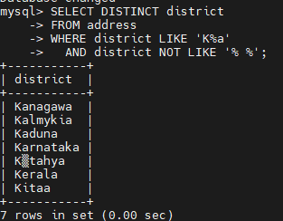
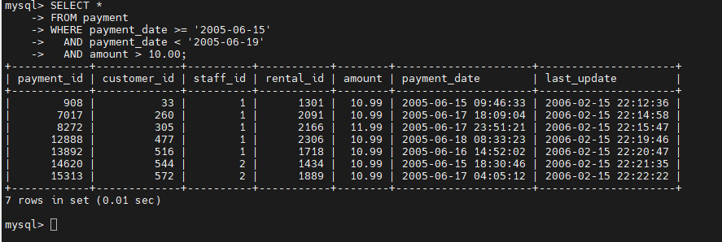
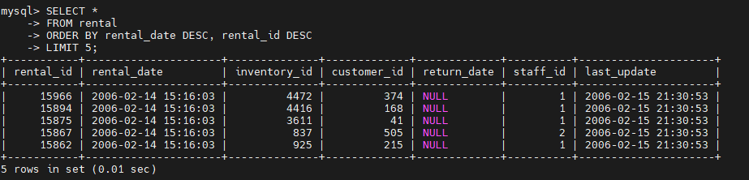
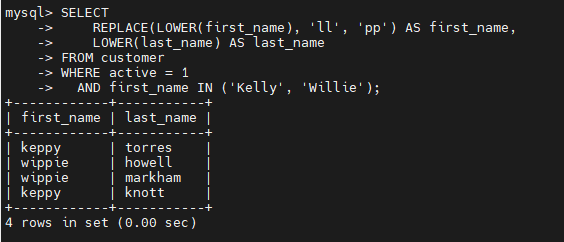
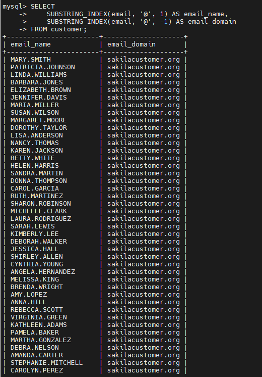
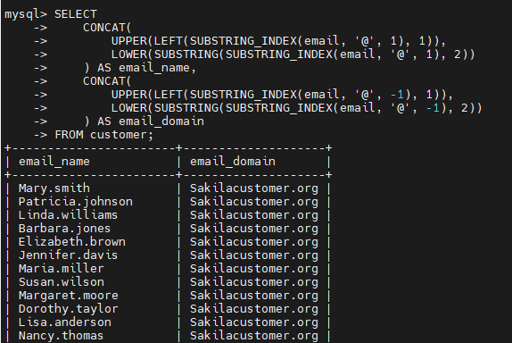

# Домашнее задание к занятию «SQL. Часть 1»  - `Туркменов Роман`
 
---
### Задание 1

Получите уникальные названия районов из таблицы с адресами, которые начинаются на “K” и заканчиваются на “a” и не содержат пробелов.

## Решение
Подготовка, заходим в БД.

```bash
cd ~/mysql-homework
docker compose up -d
docker compose exec mysql mysql -u sys_temp -p
```
Пароль: TempPass123!

В консоли MySQL:

```sql
USE sakila;
```
##  Уникальные районы на K…a без пробелов

```sql
SELECT DISTINCT district
FROM address
WHERE district LIKE 'K%a'
  AND district NOT LIKE '% %';
```

`DISTINCT` убирает повторы, `LIKE` проверяет начало и конец строки, `NOT LIKE` исключает пробелы.



---

### Задание 2

Получите из таблицы платежей за прокат фильмов информацию по платежам, которые выполнялись в промежуток с 15 июня 2005 года по 18 июня 2005 года **включительно** и стоимость которых превышает 10.00.

## Решение

```sql
SELECT *
FROM payment
WHERE payment_date >= '2005-06-15'
  AND payment_date < '2005-06-19'
  AND amount > 10.00;
```



---

### Задание 3

Получите последние пять аренд фильмов.

## Решение

```sql
SELECT *
FROM rental
ORDER BY rental_date DESC, rental_id DESC
LIMIT 5;
```

Сортировка от новых аренд к старым; `LIMIT 5` оставляет пять строк.



---

### Задание 4

Одним запросом получите активных покупателей, имена которых Kelly или Willie. 

Сформируйте вывод в результат таким образом:
- все буквы в фамилии и имени из верхнего регистра переведите в нижний регистр,
- замените буквы 'll' в именах на 'pp'.

## Решение

```sql
SELECT
    REPLACE(LOWER(first_name), 'll', 'pp') AS first_name,
    LOWER(last_name) AS last_name
FROM customer
WHERE active = 1
  AND first_name IN ('Kelly', 'Willie');
```

`LOWER` переводит буквы в нижний регистр, `REPLACE` заменяет `ll` на `pp` в именах.




---

### Задание 5*

Выведите Email каждого покупателя, разделив значение Email на две отдельных колонки: в первой колонке должно быть значение, указанное до @, во второй — значение, указанное после @.

## Решение

```sql
SELECT
    SUBSTRING_INDEX(email, '@', 1) AS email_name,
    SUBSTRING_INDEX(email, '@', -1) AS email_domain
FROM customer;
```

Первая колонка содержит часть до `@`, вторая — после `@`.



---

### Задание 6*

Доработайте запрос из предыдущего задания, скорректируйте значения в новых колонках: первая буква должна быть заглавной, остальные — строчными.

```sql
SELECT
    CONCAT(
        UPPER(LEFT(SUBSTRING_INDEX(email, '@', 1), 1)),
        LOWER(SUBSTRING(SUBSTRING_INDEX(email, '@', 1), 2))
    ) AS email_name,
    CONCAT(
        UPPER(LEFT(SUBSTRING_INDEX(email, '@', -1), 1)),
        LOWER(SUBSTRING(SUBSTRING_INDEX(email, '@', -1), 2))
    ) AS email_domain
FROM customer;
```

`UPPER` делает первую букву заглавной, `LOWER` — остальные строчными, `CONCAT` соединяет части.


