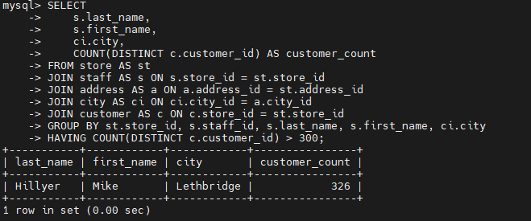
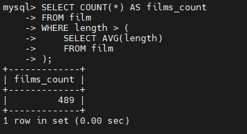
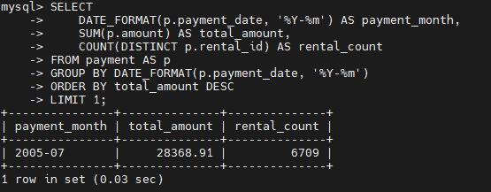

# Домашнее задание к занятию «SQL. Часть 2»  - `Туркменов Роман`

 ---
## Подготовка (исходя из предыдущих заданий)

```bash
cd ~/mysql-homework
docker compose up -d
docker compose exec mysql mysql -u sys_temp -p
```
`MySQL`:
```sql
USE sakila;
```

 ### Задание 1

Одним запросом получите информацию о магазине, в котором обслуживается более 300 покупателей, и выведите в результат следующую информацию: 
- фамилия и имя сотрудника из этого магазина;
- город нахождения магазина;
- количество пользователей, закреплённых в этом магазине.

### Решение
```sql
SELECT
    s.last_name,
    s.first_name,
    ci.city,
    COUNT(DISTINCT c.customer_id) AS customer_count
FROM store AS st
JOIN staff AS s ON s.store_id = st.store_id
JOIN address AS a ON a.address_id = st.address_id
JOIN city AS ci ON ci.city_id = a.city_id
JOIN customer AS c ON c.store_id = st.store_id
GROUP BY st.store_id, s.staff_id, s.last_name, s.first_name, ci.city
HAVING COUNT(DISTINCT c.customer_id) > 300;
```
`JOIN` объединяет связанные таблицы, `GROUP BY` группирует по сотруднику и магазину, `HAVING` оставляет магазины с более чем 300 покупателями.



---

### Задание 2

Получите количество фильмов, продолжительность которых больше средней продолжительности всех фильмов.
### Решение

```sql
SELECT COUNT(*) AS films_count
FROM film
WHERE length > (
    SELECT AVG(length)
    FROM film
);
```


---

### Задание 3

Получите информацию, за какой месяц была получена наибольшая сумма платежей, и добавьте информацию по количеству аренд за этот месяц.

```sql
SELECT
    DATE_FORMAT(p.payment_date, '%Y-%m') AS payment_month,
    SUM(p.amount) AS total_amount,
    COUNT(DISTINCT p.rental_id) AS rental_count
FROM payment AS p
GROUP BY DATE_FORMAT(p.payment_date, '%Y-%m')
ORDER BY total_amount DESC
LIMIT 1;
```
`SUM` вычисляет сумму платежей за месяц, `COUNT(DISTINCT rental_id)` — число уникальных аренд.


 
