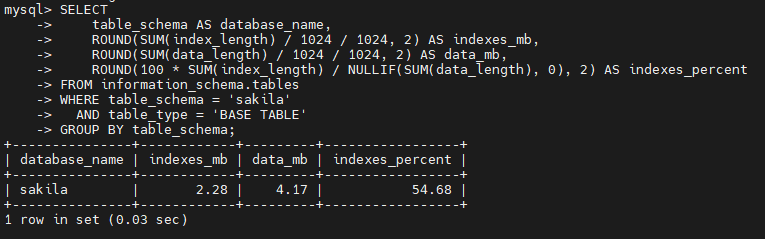

# Домашнее задание к занятию «Индексы»  - `Туркменов Роман`

### Задание 1

Напишите запрос к учебной базе данных, который вернёт процентное отношение общего размера всех индексов к общему размеру всех таблиц.

## Подготовка

Используется MySQL 8.0 и ранее восстановленная база `sakila`.

```bash
cd ~/mysql-homework
docker compose up -d
docker compose exec mysql mysql -u sys_temp -p
```
Пароль: TempPass123!

```sql
USE sakila;
```

### Решение

```sql
SELECT
    table_schema AS database_name,
    ROUND(SUM(index_length) / 1024 / 1024, 2) AS indexes_mb,
    ROUND(SUM(data_length) / 1024 / 1024, 2) AS data_mb,
    ROUND(100 * SUM(index_length) / NULLIF(SUM(data_length), 0), 2) AS indexes_percent
FROM information_schema.tables
WHERE table_schema = 'sakila'
  AND table_type = 'BASE TABLE'
GROUP BY table_schema;
```

`index_length` — объём индексов; `data_length` — объём данных таблиц; `NULLIF` предотвращает деление на ноль.



---

### Задание 2

Выполните explain analyze следующего запроса:
```sql
select distinct concat(c.last_name, ' ', c.first_name), sum(p.amount) over (partition by c.customer_id, f.title)
from payment p, rental r, customer c, inventory i, film f
where date(p.payment_date) = '2005-07-30' and p.payment_date = r.rental_date and r.customer_id = c.customer_id and i.inventory_id = r.inventory_id
```
- перечислите узкие места;
- оптимизируйте запрос: внесите корректировки по использованию операторов, при необходимости добавьте индексы.

### Решение

### Узкие места

  1. Нет связи `film` с `inventory` (`f.film_id = i.film_id`): возникает декартово произведение и резко растёт число строк.
  2. Неверная связь платежа и аренды: `p.payment_date = r.rental_date` сравнивает временные метки, а не идентификаторы аренды. Правильно: `p.rental_id = r.rental_id`.
  3. `DATE(p.payment_date)` оборачивает индексируемое поле функцией, что может препятствовать эффективному диапазонному поиску.
  4. `DISTINCT` вместе с оконной `SUM(...) OVER (...)` добавляет вычисления и удаление дублей. Для агрегирования по покупателю и фильму достаточно `GROUP BY`.
  5. Старый синтаксис соединения через запятые затрудняет проверку связей. Лучше использовать явные `JOIN`.


### 2.3. Исправленный запрос

```sql
EXPLAIN ANALYZE
SELECT
    c.customer_id,
    CONCAT(c.last_name, ' ', c.first_name) AS customer_name,
    f.title AS film_title,
    SUM(p.amount) AS total_amount
FROM payment AS p
JOIN rental AS r ON p.rental_id = r.rental_id
JOIN customer AS c ON r.customer_id = c.customer_id
JOIN inventory AS i ON r.inventory_id = i.inventory_id
JOIN film AS f ON i.film_id = f.film_id
WHERE p.payment_date >= '2005-07-30 00:00:00'
  AND p.payment_date <  '2005-07-31 00:00:00'
GROUP BY c.customer_id, c.last_name, c.first_name, f.film_id, f.title;
```

Этот запрос возвращает **сумму платежей за указанный день по каждому покупателю и фильму**. Добавлены название фильма и `customer_id`, чтобы группировка была однозначной.

### Индекс и повторное измерение

```sql
SHOW INDEX FROM payment;
```

**Вывод:** устранено декартово произведение, исправлена связь `payment` → `rental`, фильтр по дате сделан диапазонным, оконная функция заменена группировкой.

## Дополнительные задания (со звёздочкой*)
Эти задания дополнительные, то есть не обязательные к выполнению, и никак не повлияют на получение вами зачёта по этому домашнему заданию. Вы можете их выполнить, если хотите глубже шире разобраться в материале.

---

### Задание 3*

Самостоятельно изучите, какие типы индексов используются в PostgreSQL. Перечислите те индексы, которые используются в PostgreSQL, а в MySQL — нет.

PostgreSQL поддерживает методы индексации **B-tree, Hash, GiST, SP-GiST, GIN, BRIN**. В MySQL 8.0 существуют B-tree-подобные и Hash-индексы (в зависимости от движка), а также FULLTEXT и SPATIAL, но нет прямых аналогов следующих методов PostgreSQL:

- **GiST** — обобщённый индекс, в том числе для геометрических данных, диапазонов и поиска по близости.
- **SP-GiST** — индекс для структур с разбиением пространства (например, деревьев поиска).
- **GIN** — инвертированный индекс, удобен для массивов, `jsonb`, полнотекстового поиска.
- **BRIN** — компактный индекс по диапазонам блоков, особенно полезен для очень больших таблиц с коррелированным порядком данных.

Важно: MySQL имеет отдельные механизмы FULLTEXT/SPATIAL и индексацию JSON через специальные подходы; отсутствие одноимённого метода не означает полное отсутствие аналогичных возможностей.

Официальная документация: https://www.postgresql.org/docs/current/indexes-types.html
