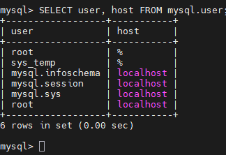
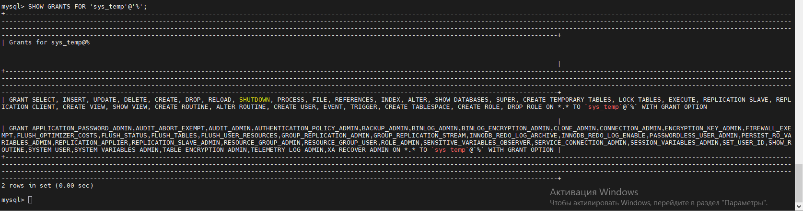
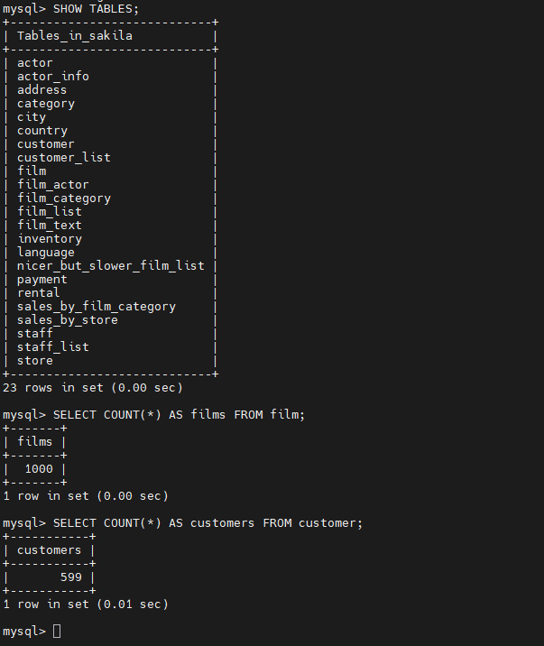
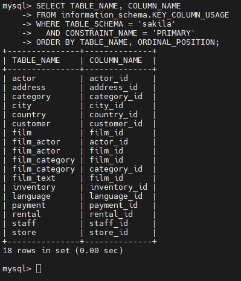
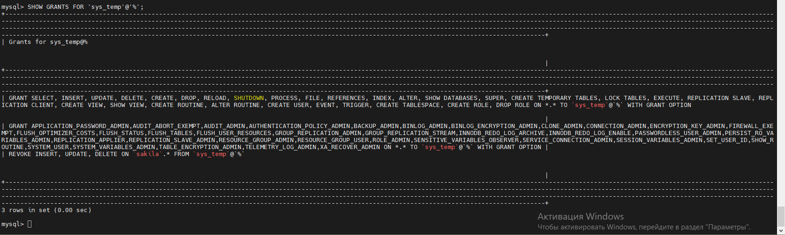

# Домашнее задание к занятию «Работа с данными (DDL/DML)»  - `Туркменов Роман`
 
---

Задание можно выполнить как в любом IDE, так и в командной строке.

### Задание 1
1.1. Поднимите чистый инстанс MySQL версии 8.0+. Можно использовать локальный сервер или контейнер Docker.

1.2. Создайте учётную запись sys_temp. 

1.3. Выполните запрос на получение списка пользователей в базе данных. (скриншот)

1.4. Дайте все права для пользователя sys_temp. 

1.5. Выполните запрос на получение списка прав для пользователя sys_temp. (скриншот)

1.6. Переподключитесь к базе данных от имени sys_temp.

Для смены типа аутентификации с sha2 используйте запрос: 
```sql
ALTER USER 'sys_test'@'localhost' IDENTIFIED WITH mysql_native_password BY 'password';
```
1.6. По ссылке https://downloads.mysql.com/docs/sakila-db.zip скачайте дамп базы данных.

1.7. Восстановите дамп в базу данных.

1.8. При работе в IDE сформируйте ER-диаграмму получившейся базы данных. При работе в командной строке используйте команду для получения всех таблиц базы данных. (скриншот)

---

## Решение
### 1.1. Поднять чистый экземпляр MySQL 8.0+

Создаём каталог и файл Docker Compose:

```bash
mkdir -p ~/mysql-homework
cd ~/mysql-homework
nano compose.yaml
```

`compose.yaml`:

```yaml
services:
  mysql:
    image: mysql:8.0
    container_name: mysql-homework
    restart: unless-stopped
    environment:
      MYSQL_ROOT_PASSWORD: root_password
    ports:
      - "127.0.0.1:3306:3306"
    volumes:
      - mysql-data:/var/lib/mysql

volumes:
  mysql-data:
```

Запускаем MySQL и проверяем контейнер:

```bash
docker compose up -d
docker compose ps
docker compose exec mysql mysql -u root -p
```

Вводим пароль `root_password`, затем проверяем версию:

```sql
SELECT VERSION();
```

### 1.2. Создать учётную запись `sys_temp`

В консоли MySQL под `root`:

```sql
CREATE USER 'sys_temp'@'%' IDENTIFIED BY 'TempPass123!';
```
### 1.3. Получить список пользователей

```sql
SELECT user, host FROM mysql.user;
```
 

### 1.4. Выдать все права пользователю `sys_temp`

```sql
GRANT ALL PRIVILEGES ON *.* TO 'sys_temp'@'%' WITH GRANT OPTION;
```
### 1.5. Получить список прав пользователя

```sql
SHOW GRANTS FOR 'sys_temp'@'%';
```



### 1.6. Переподключиться от имени `sys_temp`

Выходим из MySQL:

```sql
EXIT;
```

В терминале Ubuntu:

```bash
docker compose exec mysql mysql -u sys_temp -p
```

Вводим пароль `TempPass123!` и проверяем пользователя:

```sql
SELECT CURRENT_USER();
SHOW DATABASES;
```

### 1.7. Скачать дамп Sakila

Выходим из MySQL:

```sql
EXIT;
```

В терминале Ubuntu:

```bash
sudo apt update
sudo apt install -y curl unzip
curl -fL -o sakila-db.zip https://downloads.mysql.com/docs/sakila-db.zip
unzip sakila-db.zip
ls -lh sakila-db/
```

Дамп содержит `sakila-schema.sql` (структура) и `sakila-data.sql` (данные).

### 1.8. Восстановить дамп и вывести таблицы

Копируем оба файла внутрь контейнера:

```bash
docker compose cp sakila-db/sakila-schema.sql mysql:/tmp/sakila-schema.sql
docker compose cp sakila-db/sakila-data.sql mysql:/tmp/sakila-data.sql
```

Подключаемся от имени `sys_temp`:

```bash
docker compose exec mysql mysql -u sys_temp -p
```

В консоли MySQL последовательно выполняем:

```sql
SOURCE /tmp/sakila-schema.sql;
SOURCE /tmp/sakila-data.sql;
USE sakila;
SHOW TABLES;
```

`SOURCE` выполняет SQL-файлы. В стандартной базе Sakila должно быть **16 таблиц**.

Дополнительная проверка данных:

```sql
SELECT COUNT(*) AS films FROM film;
SELECT COUNT(*) AS customers FROM customer;
```




---

### Задание 2
Составьте таблицу, используя любой текстовый редактор или Excel, в которой должно быть два столбца: в первом должны быть названия таблиц восстановленной базы, во втором названия первичных ключей этих таблиц. Пример: (скриншот/текст)
```
Название таблицы | Название первичного ключа
customer         | customer_id
```
## Решение 
| Таблица           | Первичный ключ        |
|-------------------|-----------------------|
| actor             | actor_id |
| address           | address_id |
| category          | category_id |
| city              | city_id |
| country           | country_id |
| customer          | customer_id |
| film              | film_id |
| film_actor        | actor_id, film_id |
| film_category     | film_id, category_id |
| film_text         | film_id |
| inventory         | inventory_id |
| language          | language_id |
| payment           | payment_id |
| rental            | rental_id |
| staff             | staff_id |
| store             | store_id |

Таблицы `film_actor` и `film_category` имеют составные первичные ключи.

Проверка первичных ключей SQL-запросом:

```sql
SELECT TABLE_NAME, COLUMN_NAME
FROM information_schema.KEY_COLUMN_USAGE
WHERE TABLE_SCHEMA = 'sakila'
  AND CONSTRAINT_NAME = 'PRIMARY'
ORDER BY TABLE_NAME, ORDINAL_POSITION;
```



---

## Дополнительные задания (со звёздочкой*)
Эти задания дополнительные, то есть не обязательные к выполнению, и никак не повлияют на получение вами зачёта по этому домашнему заданию. Вы можете их выполнить, если хотите глубже шире разобраться в материале.

### Задание 3*
3.1. Уберите у пользователя sys_temp права на внесение, изменение и удаление данных из базы sakila.

3.2. Выполните запрос на получение списка прав для пользователя sys_temp. (скриншот)

### 3.1. Запретить `INSERT`, `UPDATE`, `DELETE`

Выйти из `sys_temp`:

```sql
EXIT;
```

Подключиться под `root`:

```bash
docker compose exec mysql mysql -u root -p
```

Так как ранее были выданы **глобальные** права `ON *.*`, для ограничения одной базы включаем частичный отзыв прав MySQL 8.0:

```sql
SET GLOBAL partial_revokes = ON;
REVOKE INSERT, UPDATE, DELETE ON sakila.* FROM 'sys_temp'@'%';
```

`SET GLOBAL` действует до перезапуска сервера, если настройка не закреплена отдельно. Для текущего выполнения достаточно.

### 3.2. Проверить права

```sql
SHOW GRANTS FOR 'sys_temp'@'%';
```

В выводе должно появиться ограничение `REVOKE INSERT, UPDATE, DELETE ON sakila.*`.

 


